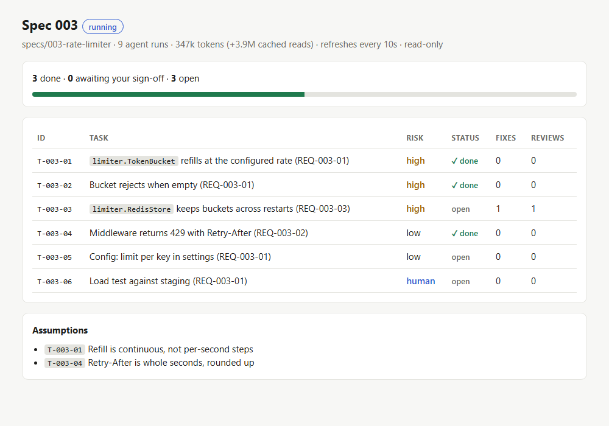

# specsteward

[](https://github.com/Dinusha-Ekanayake/specsteward/actions/workflows/ci.yml)
[](https://github.com/Dinusha-Ekanayake/specsteward/releases)
[](LICENSE)


Spec-driven development on autopilot for [Claude Code](https://claude.com/claude-code).

You approve a spec. Subagents then implement it task by task: a Sonnet implementer writes the code test-first, a scripted quality gate checks it, and a reviewer (Opus for risky tasks, Sonnet for routine ones) signs it off. Hard caps stop runaway loops, the gates hold even against an agent that tries to work around them, and you approve from your phone if you like.

```
/specsteward:run plan "rate limiter"  ->  planner (Opus) drafts spec, plan, tasks; asks up to 5 questions
        you approve the spec          ->  in the terminal, or "approve 003" from your phone
/specsteward:run 003                  ->  per task group: brief -> implementer (Sonnet)
                                          -> gate -> reviewer (Opus if risk=high) -> tick
        last task done                ->  converger adds any missing work as new tasks
        you ship                      ->  "ship 003": commit, push, PR (each one asks you)
```

<picture>
  <source media="(prefers-color-scheme: dark)" srcset="docs/images/dashboard-dark.png">
  
</picture>

The status line shows the same run at a glance: `SDD 003 ▸ 3/6 ✓ · 347k tok · next T-003-03`.

## Why

Long agent runs fail in predictable ways. specsteward has a mitigation for each:

| Problem | What specsteward does |
|---|---|
| Every subagent re-reads the whole spec | A generated **brief** per task group: the task rows, matching plan lines, requirements and signatures of related code, capped in size |
| Agents read files one by one | A **graphify code graph** is installed, built and kept fresh automatically; agents query it first |
| Reviewing everything with the biggest model is expensive | **Risk tags** (`low`, `high`, `human`) pick the reviewer model; high-risk reviews also write one adversarial test |
| Lint and test output floods the context | One **gate** command prints a 2-line summary plus only the failing lines |
| Loops that never converge | Halts on the same failure twice, too many fix attempts, a second review round with open findings, an agent-run cap (counted by a hook), or no progress between automatic continues. Resetting a cap needs your permission |
| Agents working around the gate | Approval is bound to the spec's content; `done` needs a passing gate and a clean review of the current code; gate config changes fail the check; run state cannot be edited |
| A cloned repo runs commands on your machine | `sdd.toml` commands run only after you trust that exact file |
| Agent context grows until it drifts | The implementer is restarted every few tasks |
| Green tests that prove nothing | The reviewer checks that tests would fail if the code were wrong |
| "Done" that is not done | After the last task a **converger** compares the code with the spec and appends the missing work as new tasks for you to approve |
| Silent guesses on ambiguous specs | The planner marks up to five `[NEEDS CLARIFICATION]` questions for you to answer before approval; during the run, choices are logged as assumptions and behaviour-changing ones halt the run and ask you |
| Specs that do not hang together | `sdd analyze` (no model) checks clarifications, placeholders, requirement coverage by tasks, vague wording and plan paths; `approve` refuses CRITICAL findings |
| Project rules forgotten mid-run | `specs/constitution.md`: its MUST rules go into every brief, and the reviewer treats a violation as CRITICAL |
| Overclaiming wording in regulated domains | Optional banned-phrase scan in the gate |
| You are away from the laptop | Approvals and answers over Telegram or Discord |

## Install

### Requirements

| What | Needed for | How you get it |
|---|---|---|
| [Claude Code](https://claude.com/claude-code) | everything | install it first |
| `bash` | the CLI and hooks | built in on macOS and Linux; on Windows it comes with [Git for Windows](https://git-scm.com/download/win), which Claude Code uses too |
| Python 3.11+ | the CLI (standard library only; nothing to `pip install`) | [python.org](https://www.python.org/downloads/), or have [uv](https://docs.astral.sh/uv/) and specsteward uses a uv-managed Python automatically |
| `git` | branches, diffs, the gate fingerprint | [git-scm.com](https://git-scm.com/) |
| graphify | the code graph agents query | **installed automatically** (pinned) with uv, pipx or pip |
| [Bun](https://bun.sh) | phone control only (it runs the official Telegram and Discord plugins) | **installed automatically** (pinned) when you set up phone control |
| `gh` (GitHub CLI) | opening the PR when you say "ship" (optional) | [cli.github.com](https://cli.github.com/) |

`bash .sdd/bin/sdd doctor` checks all of these and prints the fix for anything missing.

```text
/plugin marketplace add Dinusha-Ekanayake/specsteward
/plugin install specsteward@specsteward
```

Or from a local clone: `/plugin marketplace add /path/to/specsteward`.

## Quick start

In your project:

```text
/specsteward:init
```

This detects your stack (Python, Node, Go, Rust or a Makefile) and builds the gate from the tools the project already uses, so `sdd.toml` normally needs no editing. It also writes spec templates under `specs/_template/`, `.gitignore` entries and permission rules, then starts building the code graph in the background. It runs `sdd doctor`, which prints a fix for anything missing, and `sdd check` once. Restart Claude Code so the permission rules load.

Optional: `bash .sdd/bin/sdd init --statusline` shows the run in Claude Code's status line, and `.sdd/dashboard.html` is a read-only page of the run you can keep open in a browser.

Then:

1. `/specsteward:run plan <topic>` drafts a spec (status `Draft`).
2. Read it. Approve with `bash .sdd/bin/sdd approve 001 --start` (a permission prompt only you can answer), or reply `approve 001` from your phone.
3. `/specsteward:run 001` runs the tasks. It stops at the gates below.

For a bug, `/specsteward:run fix "<what is broken>"` drafts a small fix spec instead: reproduction, expected and actual behaviour, root cause, and a failing regression test as the first task. It then goes through the same approval and run.

Tip: run the orchestrating session on Sonnet (`/model sonnet`). Opus is still used wherever an agent or a high-risk review asks for it, because each agent sets its own model.

## What stays with you

| Gate | How it works |
|---|---|
| Spec approval | `sdd approve` is an **ask** permission rule, bound to the spec's content. Nothing implements an unapproved or since-edited spec |
| Trust, start, resume | **ask** rules: trusting `sdd.toml`, starting a run and resuming after a halt (which resets counters) |
| `human` tasks | Real-data runs, interpreting results, release steps. Prepared automatically, ticked `[?]` for your sign-off |
| Behaviour-changing questions | The run halts and asks; answer with `answer: ...` |
| Commit, push, PR | `git commit`, `git push`, `gh pr create` are **ask** rules |

## Phone control (Telegram or Discord)

specsteward uses Anthropic's official Telegram or Discord channel plugin instead of its own bot. Run `/specsteward:remote` for guided setup, including Bun. See [docs/phone.md](docs/phone.md).

| You send | Effect |
|---|---|
| `status` | Progress, halt reason, assumptions |
| `approve 003` | Approves the spec and starts the run |
| `changes 003: ...` | Sends your comments to the planner |
| `answer: ...` | Answers a halted question and resumes |
| `resume` / `stop` | Continue / pause |
| `ship 003` | Commit, push and PR (each still needs your tap on the permission prompt) |

The laptop must stay awake while a run is going.

## Configuration

Everything project-specific lives in `sdd.toml`. See [docs/configuration.md](docs/configuration.md). `init` detects the stack; presets `python`, `node`, `go`, `rust` and `generic` can be forced with `--preset`. Any edit to `sdd.toml` needs `sdd trust` before its commands run again.

## Task table

`specs/<NNN>-<slug>/tasks.md` holds a table the tool reads and updates:

```markdown
| ID | Task | Test | Risk | Status |
|---|---|---|---|---|
| T-003-01 | `limiter.TokenBucket` refills at the configured rate | refill after 1s | high | [ ] |
```

Risk is `low`, `high` or `human`. Status is `[ ]` open, `[x]` done, `[?]` waiting for you.

## CLI

`bash .sdd/bin/sdd <command>` (the shim is created by `init` and refreshed at session start):
`init`, `doctor`, `trust`, `analyze`, `check`, `brief`, `start`, `approve`, `next`, `agent`, `review`, `done`, `assume`, `halt`, `resume`, `stop`, `status`, `statusline`, `dashboard`, `graph`, `remote`. See [docs/how-it-works.md](docs/how-it-works.md).

## Security

See [SECURITY.md](SECURITY.md) and [docs/security.md](docs/security.md). In short: the gates are permission prompts, `sdd.toml` commands run only once you trust the file, approvals are bound to the spec's content, run state cannot be edited by agents, the channel's allowlist should contain only you, secrets never go in chat, and the plugin never commits or pushes by itself.

## Privacy

specsteward collects no telemetry and sends nothing anywhere by itself. Everything it records stays on your machine: `.sdd/` in the project and `~/.claude/specsteward/` for trust and approvals. The only network calls it makes are installing pinned versions of graphify and Bun, and the phone channel you choose to set up.

## Limitations

- The token budget (`[limits] max_tokens`) is checked when a subagent or the session stops, so a run can go a little past it before halting. Cached reads are reported but not counted.
- One run per checkout. For parallel specs, `bash .sdd/bin/sdd worktree <NNN>` creates a sibling git worktree on the spec's branch; worktrees share trust and approvals and each keeps its own run.
- Trust and approvals are tied to the repository's folder path: after moving or renaming it, run `sdd trust` and approve the spec again.
- Graphify is installed automatically (pinned version) unless you set `[graphify] auto = false`.
- Subagents start without conversation context, so briefs matter; check "BRIEF GAPS" in reports.
- Quality still depends on your tests and spec. Green checks prove consistency, not correctness; the reviewer is a second opinion, not a guarantee.
- Phone control needs [Bun](https://bun.sh) (installed automatically by `/specsteward:remote`) and a session started with `--channels`.

## Uninstall

1. `/plugin uninstall specsteward@specsteward` (and `/plugin marketplace remove specsteward`).
2. In each project: delete `.sdd/` and, if you no longer want them, `sdd.toml`, `specs/_template/`, `specs/constitution.md` and `.graphifyignore`; remove the `bash .sdd/bin/sdd` and `Edit(.sdd/**)` rules from `.claude/settings.json`.
3. Delete `~/.claude/specsteward/` (trust store and install logs).
4. Optional, if specsteward installed them: `uv tool uninstall graphifyy` (or `pipx uninstall graphifyy`), and Bun with `brew uninstall bun`, `winget uninstall Oven-sh.Bun`, or by deleting `~/.bun`.

## Development

```bash
python -m venv .venv && .venv/bin/pip install pytest pytest-cov ruff mypy
bash bin/sdd init --preset python   # the repo uses itself
bash .sdd/bin/sdd check
```

See [CONTRIBUTING.md](CONTRIBUTING.md). MIT licensed.

The clarify step, the cross-artifact analysis and the constitution are inspired by GitHub's [Spec Kit](https://github.com/github/spec-kit).
